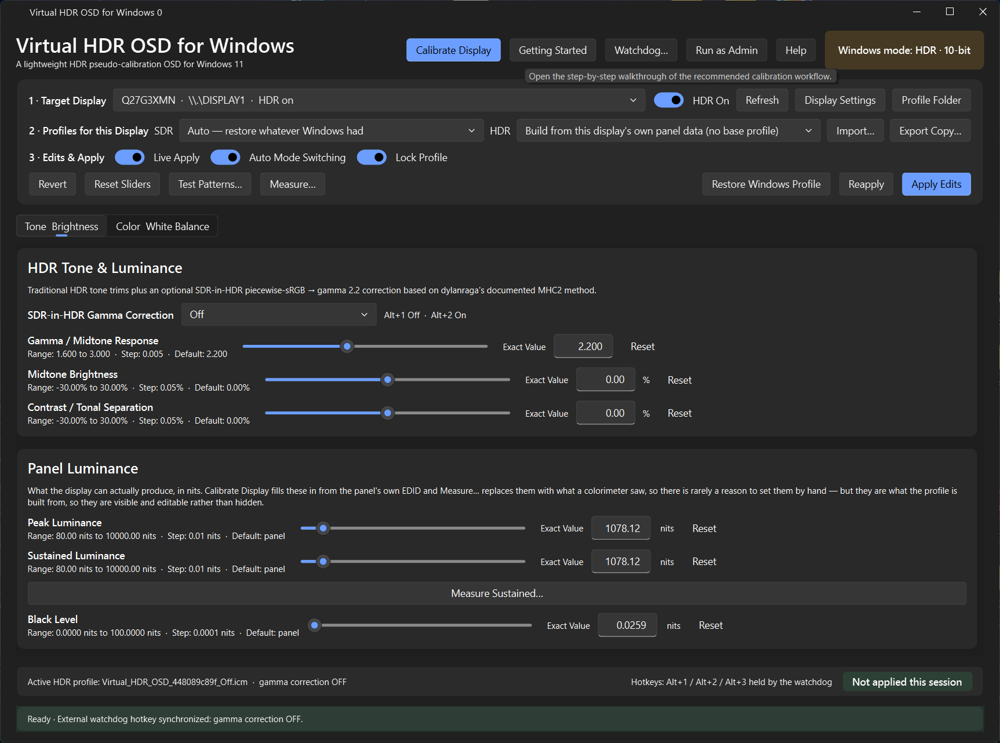
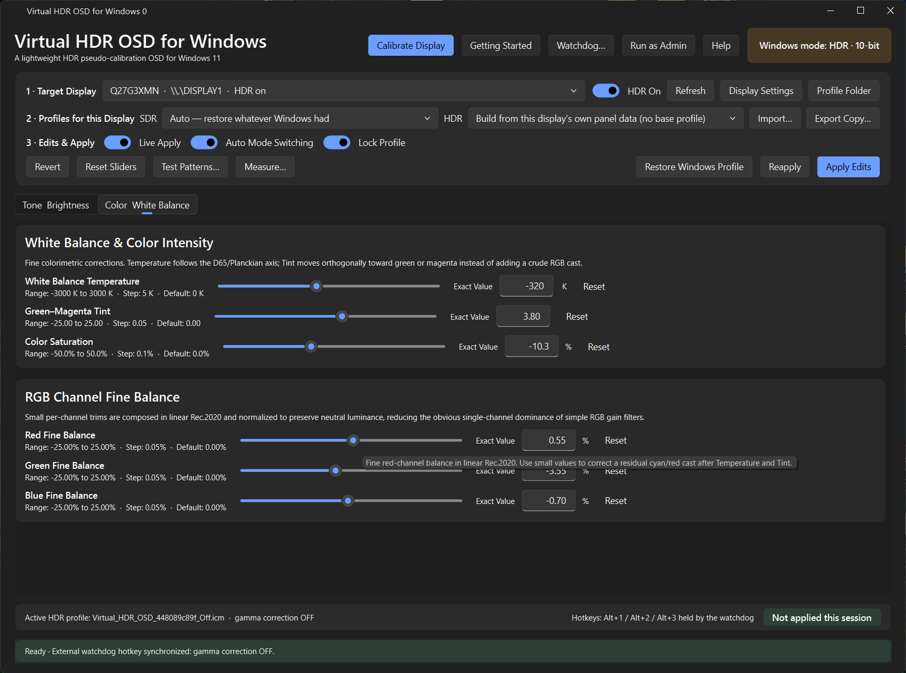

# Virtual HDR OSD for Windows

Virtual HDR OSD for Windows is a lightweight Windows 11 HDR profile editor designed as a software counterpart to the controls that many monitors disable when HDR mode is enabled.

*Most HDR monitors lock or substantially reduce access to their physical OSD controls after switching to HDR. White balance, gamma, per-channel RGB balance, saturation, brightness, contrast, and related adjustments may become unavailable or much more limited. Virtual HDR OSD provides a practical software pseudo-calibration layer for making small subjective corrections to an existing Windows HDR ICC/ICM profile.*

The application is intended for visual fine-tuning: correcting a slight warm/cool cast, reducing a green or magenta bias, matching HDR white balance more closely to a preferred SDR appearance, or making small tonal changes that the monitor's HDR OSD does not expose.

Adjust HDR profiles on Windows 11 using gamma, brightness, contrast and colour
controls similar to a monitor menu. Start with an existing profile or create one
using the information reported by your display. Check your adjustments with the
built-in patterns or the optional colorimeter tools.

Changes are stored in Windows colour profiles. SDR content remains SDR, and the
monitor's hardware settings are unchanged.

## Download and run

Download the portable EXE from [Releases](https://github.com/Mixomo/Virtual-HDR-OSD-for-Windows-11/releases) and open it. It includes
its runtime; Python is not required. The matching `.sha256.txt` file is provided
for checking download integrity.

To run from source, download or clone the repository and open
**1- Install & Run.bat**. It prepares Python and dependencies inside the project
folder on the first run, then reuses them.

## Quick start

1. Select your monitor under **Target Display** and turn HDR on.
2. Click **Calibrate Display** to use the display's reported data, or select an
   installed HDR profile. Use **Import…** for an ICC/ICM file that is not installed.
3. Choose the SDR profile to restore when HDR is off. Select **Auto** to use the
   previous Windows profile, or **Leave unmanaged** if another app handles SDR.
4. Open **Test Patterns…** for guided calibration, or adjust the controls directly.
   Turn on **Live Apply** to see edits as you make them.
5. Click **Apply Edits** to save and apply the result. Use **Export Copy…** for a backup.
6. If Windows loses the profile when switching SDR/HDR, enable **Lock Profile** to
   install the optional watchdog.

**Getting Started** opens the setup guide again at any time.

The display's specifications describe its model. To start from measurements of your
own monitor, use a profile made with an instrument. Adjusting by eye helps you judge
the image, but does not provide an instrument reading.

## Profiles and controls

Your selected base profile is kept as it is; edits go into a working copy. For SDR,
the app uses an existing profile and restores it when needed.

| Action | Use |
| --- | --- |
| **Apply Edits** | Save the current HDR edits and apply the working profile. |
| **Reapply** | Restore the selected profile association. |
| **Live Apply** | Apply slider changes automatically. |
| **Automatic Mode Switching** | Follow Windows SDR/HDR changes while the app is open. |
| **Revert** | Reload the base profile without your edits. |
| **Reset Sliders** | Reset adjustments and remove the paired measured greyscale correction. |
| **Restore Windows Profile** | Return to the previous Windows profile. This is separate from uninstalling the watchdog. |
| **Export Copy…** | Save a copy without replacing the base file. |

Gamma, Midtone Brightness and Contrast adjust tone. White Balance Temperature and
Green-Magenta Tint adjust the white point. Color Saturation and RGB Fine Balance
provide additional colour adjustments. Drag a slider, use the mouse wheel or
**Exact Value** to enter a number. A control's reset returns its neutral value.

Each display keeps its settings and profile choices. Disconnecting a monitor pauses
its calibration until that monitor is available again.

## SDR-in-HDR gamma correction

In HDR mode, Windows displays SDR using an sRGB curve with a linear section near
black. This correction replaces the lower part with a gamma curve based on your
Gamma setting. Windows **SDR content brightness** stays at its current value.

| Option | Use |
| --- | --- |
| **Off** | Keep the Windows curve as the starting point for tone adjustments. |
| **Auto (Recommended)** | Use the selected display's current Windows SDR reference white. |
| **100 nits / Brightness 5** | Fixed reference-white setting. |
| **200 nits / Brightness 30** | Fixed reference-white setting. |
| **300 nits / Brightness 55** | Fixed reference-white setting. |
| **400 nits / Brightness 80** | Fixed reference-white setting. |

The whole display receives the correction, including dark areas of HDR content.
Use **Alt+1** to turn it off when appropriate. Gamma alone preserves SDR white and
the higher HDR range; with correction Off, Brightness and Contrast can still affect
the wider tone range. See the [technical reference](docs/TECHNICAL.md#tone-and-colour)
for the processing order.

## The guided run

**Test Patterns…** offers **Guided calibration** and **Browse all patterns** as separate
sessions. The guide uses a 4-step sequence. The first three let you find the level where
the shape disappears. The final step is for gamma and tone adjustments.

| step | purpose | what to do |
| --- | --- | --- |
| Black level | Set the black threshold. | Adjust until the shape disappears. |
| Peak white | Set the central-window white threshold. | Adjust until the shape disappears. |
| Full-frame white | Set the full-screen white threshold. | Adjust until the circle disappears. |
| Gamma match | Compare the TARGET with the fine grey reference. | Use the pattern readout to check gamma; use Tab for profile tone controls. |

Press **Enter** to record and continue, **N** to skip a step, or **Esc** to leave.
Skipping keeps the previous reading but does not undo slider edits already applied.
Recorded values enter the editor as you go. The results screen can apply them;
you can also use **Apply Edits** afterwards.

The three luminance steps follow the same order as Windows HDR Calibration.
Their visual thresholds are not physical brightness measurements. Full-frame white
is stored separately and cannot exceed peak white.

### Matching gamma

Look at the pattern from a distance or slightly defocus your eyes. The fine grey
background should blend into a uniform level. Adjust **Custom pattern gamma** until
the TARGET appears equally bright. Use arrows for 0.005 steps, drag the slider,
or press **E** for an exact value.

The matching value gives an estimate of gamma with your current display setup.
It adjusts the pattern itself, so **do not use it directly as the profile correction**.
Use **Tab** to select the real Gamma, Midtone Brightness or Contrast controls, then
check the match again.

**G** switches between Reference match, Reference rows and Profile adjustment.
Reference rows include fixed 1.8, 2.0, 2.2 and 2.4 targets plus CUSTOM.
**P** shows a smooth average preview; use the fine reference for gamma matching.

## Pattern controls

| Key | Action |
| --- | --- |
| `Tab` | Select the next available control. |
| `←` / `→` | Adjust the selected control or threshold. |
| `↑` / `↓` | Move through stepped levels. |
| `E` | Enter an exact value. |
| `Enter` | Record, continue or apply the results. |
| `N` | Skip the current guided step. |
| `G` / `P` | Change gamma view / toggle its average preview. |
| `H` | Move the guidance panel. |
| `Esc` | Close the patterns. |

Free browsing also supports **`1`–`9`, `0`** to choose patterns and **S** to view
recorded readings. Its additional patterns include tone tracking, neutral and colour
checks. Number keys do not switch the guided session into free browsing.

A pattern remembers its own test level. Changes to the profile carry across patterns
so you can check the same adjustment in different views. HDR patterns temporarily enable Live Apply and restore
its previous setting on exit. In SDR, free browsing is reference-only.

## Optional colorimeter measurements [**NOT TESTED**]

Install the executable distribution of [ArgyllCMS](https://www.argyllcms.com/downloadwin.html)
separately, select its location in the app if needed, and use a supported instrument.
ArgyllCMS, USB drivers and spectral correction files are not bundled. Use a
**spectral correction** appropriate to the display for reliable colour readings.

Choose **Measure…**, place the instrument inside the target,
and press Enter to start. Keep it still. The confirmation shows the expected duration;
**Esc** cancels without adopting a partial run.

The 100-patch run measures black, peak white, white balance, a 33-point greyscale ramp,
and BT.709 / BT.2020 saturation sweeps. White balance and greyscale can correct the
profile. Gamut coverage is diagnostic: the final status reports BT.709, Display P3
and BT.2020 coverage through the active HDR profile and monitor preset.

**Measure Sustained…** is a separate full-screen measurement. It waits for stable
readings and records sustained luminance rather than a visual clipping threshold.

A failed measurement or a change to the display setup stops the run and shows an
explanation. Results depend on the instrument and its setup. The wide-gamut
measurement feature still needs checking with real hardware.

## Optional watchdog and hotkeys

If Windows loses the selected profile during an SDR/HDR switch, the watchdog
reapplies it. It works while the editor is closed, without Python or a console window.

Install it with **Lock Profile**, **Watchdog…**, or **2- OPTIONAL - Install-Watchdog.bat**.
For independent use, share [watchdog-standalone.zip](watchdogs%20standalone/watchdog-standalone.zip).
Configure your desired SDR/HDR profiles before installing so it captures the right pair.

| Hotkey | Action |
| --- | --- |
| **Alt+1** | Select the prepared HDR profile with gamma correction Off. |
| **Alt+2** | Select the prepared HDR profile with gamma correction On. |
| **Alt+3** | Request profile recovery. |

Alt+1/2 require the profile pair prepared by the app. Without that pair, the standalone
watchdog can still recover the existing SDR/HDR associations.

**After upgrading, rerun the updated watchdog installer.** Replacing the portable or
ZIP alone does not update an already installed background worker. Rerun the installer
also if you change the profiles it should restore.

Remove it through **Watchdog…**, by turning off **Lock Profile**, or with
**Uninstall-Watchdog.bat**. **Restore Windows Profile** restores the association but
does not uninstall the watchdog.

## Troubleshooting

| Problem | Try this |
| --- | --- |
| Edits are not visible. | Check the selected monitor, HDR mode, Live Apply and applied-profile status. Then use Apply Edits or Reapply. |
| SDR colours look wrong after leaving HDR. | Check the SDR picker, use Alt+3, and reinstall the updated watchdog if necessary. |
| A hotkey is unavailable. | Check whether another app owns it. The GUI can share runtime state with its watchdog. |
| Patterns pause or refuse a reading. | Check that the same display is connected and HDR is still on; reopen the session. |
| The colorimeter complains about its sensor position. | Move the ambient diffuser away from the lens before measuring the screen. |
| A measured curve is refused. | Check placement and monitor preset. A tone curve that reverses as input rises cannot be corrected by these profiles. |

Settings and logs are in `%LOCALAPPDATA%\Virtual_HDR_OSD_for_Windows`.
The installed watchdog and its logs are in `%LOCALAPPDATA%\ColorProfileModeWatchdog`.
See the [technical reference](docs/TECHNICAL.md#diagnostics-and-tests) for reports and tracing.

## Technical reference

[Technical reference](docs/TECHNICAL.md) covers MHC2, gamma processing, measurement
geometry, gamut limits, profile recovery, startup fallback, diagnostics and builds.

## Changelog

### 2026-10-12 - dkflint723´s Fork integration and follow-up corrections

- Integrated the fork's profile/API fixes, per-display profile selection, persistence,
  accessibility, calibration patterns and optional instrument measurements.
- Refined the guided workflow into black, central white, full-frame white and gamma;
  separated free browsing and added skip controls.
- Corrected gamma processing, refined grey matching patterns and added a fine custom
  reference slider with tone controls in the same step.
- Improved bounded profile recovery and restored the HKCU startup fallback while
  preserving Alt+1/2/3.
- Added BT.2020 measurement probes and effective gamut coverage reports.
- Updated portable/standalone packaging, tests and documentation.

See the [full changelog](CHANGELOG.md) for the fork contributions and our subsequent
adjustments. 

## License and credits

[GPL-3.0](LICENSE). See [third-party notices](THIRD_PARTY_NOTICES.md) for dependencies
and attribution.

Fork improvements are adapted from
[dkflint723/Virtual-HDR-OSD-for-Windows-11](https://github.com/dkflint723/Virtual-HDR-OSD-for-Windows-11).
The SDR-in-HDR correction follows
[dylanraga's reference](https://github.com/dylanraga/win11hdr-srgb-to-gamma2.2-icm).
ArgyllCMS and reference profile binaries are not distributed with the app.
